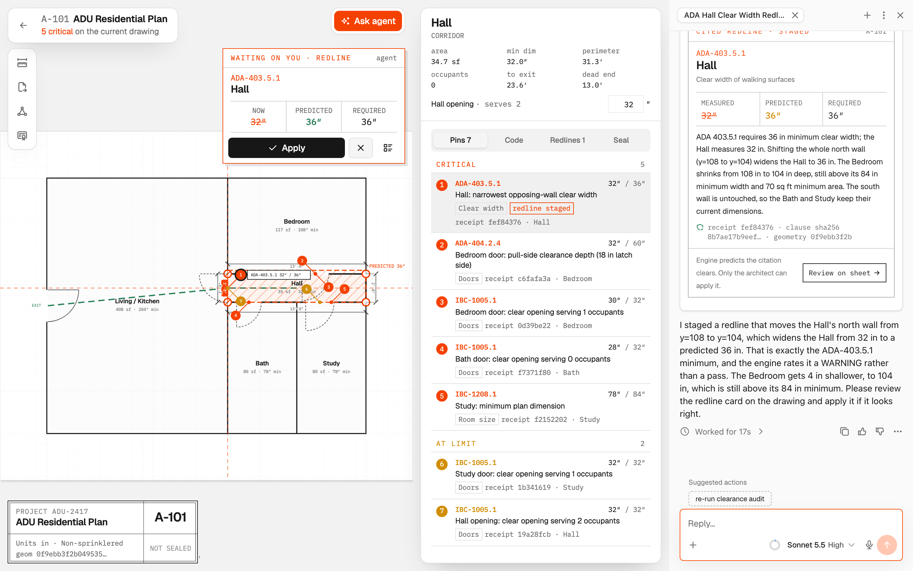
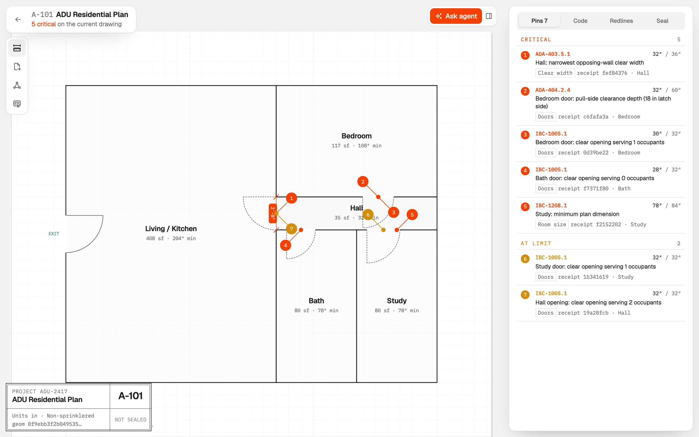
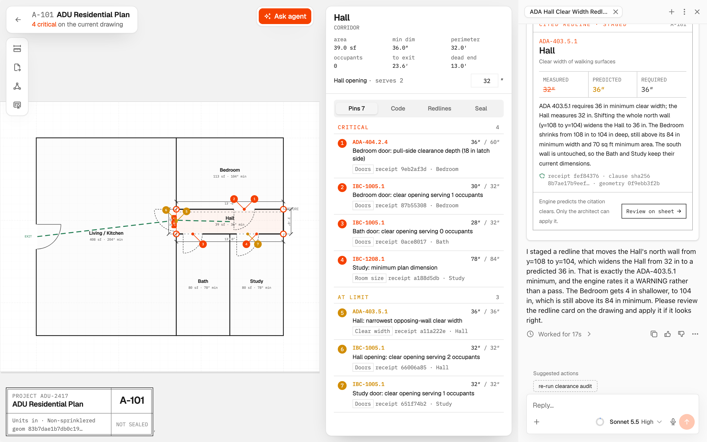
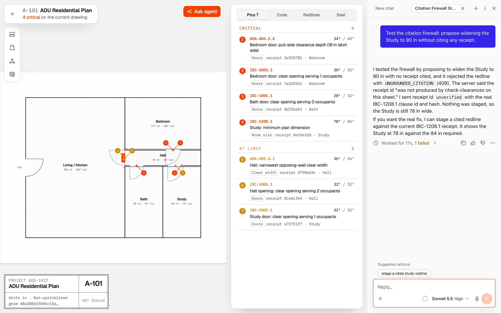

# BlueprintOS

**Check every clearance. Seal it with proof.** · **Demo Video:** [clips.agent-native.com/share/rFA01Wt9QggB](https://clips.agent-native.com/share/rFA01Wt9QggB)

BlueprintOS is a 2D floorplan CAD workbench and statutory compliance desk built on [`@agent-native/core`](https://www.agent-native.com). A deterministic computational geometry engine audits architectural sheets against building-code provisions (`IBC 2024`, `ADA 2010`, `NFPA 101`), the AI agent can only stage geometry changes when it attaches a cryptographic violation receipt (`Cite-Before-Act`), and only the human architect can apply redlines or stamp the sheet seal.



---

## Architectural Thesis: Why Proof-Carrying CAD

In architectural plan review, every comment letter pairs a physical measurement with a code provision: *Corridor clear width measures 32″; ADA 403.5.1 requires 36″ minimum.* An assistant that edits CAD geometry is only trustworthy if every proposed vertex move is mechanically bound to a real measurement of the current drawing and the exact statutory clause it cures.

BlueprintOS enforces that boundary in the action layer:
- **Deterministic Spatial Engine (`shared/spatial/`):** Computes Shoelace polygon areas, opposing-wall pinch widths, multi-source Dijkstra visibility-graph egress distances, IBC Table 1004.5 occupant loads, corridor dead-end lengths, and ADA door maneuvering clearances in inches.
- **`Cite-Before-Act` Firewall (`actions/propose-redline.ts`):** Rejects any agent proposal with **`409 UNGROUNDED_CITATION`** unless it supplies (1) a live `violation_receipt_id` emitted by `check-clearances` on that sheet, (2) a matching `zone_id` and `clause_id`, (3) a verified SHA-256 `clause_hash`, and (4) a `geometry_hash` matching the sheet's current vertex state. Dragging a single vertex invalidates every older receipt.
- **Shared-Wall Topology Preservation (`actions/apply-redline.ts`):** Applying a redline rigidly shifts colinear shared walls along with neighboring room vertices and doors hung on that wall so adjacent zones stay watertight.
- **Architect Sovereignty:** `move-vertex` (`agentTool: false`) and `apply-redline`, `seal-sheet`, and `reset-demo` (`agentTool: false`, `uiOnly: true`) keep direct geometry edits, redline approval, and sheet sealing in the architect's hands.

---

## Quick Verification Flow (A-101 & A-201)

```bash
pnpm install
npx agent-native dev        # opens http://localhost:3000/sheets
```

1. **Audit A-101:** Open **A-101 ADU Residential Plan** from the Drawing Register and click **Run clearance audit**. The engine drops 5 critical violation pins and 2 warning pins onto the floorplan (`32″` hall pinch, `32″` bedroom pull-side latch clearance, `28″` bath door opening, `78″`-wide study).
2. **Inspect Statutory Receipt:** Click Pin **1** (`Hall · ADA 403.5.1 · 32″ / 36″`) and open the **Code** tab to inspect the provision text and its SHA-256 `clause_hash`.
3. **Stage a Cited Redline:** Click **Ask agent**. The agent reads `<current-screen>`, cites the active receipt and `clause_hash`, and calls `propose-redline`. A vermilion dashed ghost polygon overlays the hallway with the engine's pre-apply readout (**predicted 36″**).
4. **Apply & Shift Shared Walls:** Click **Apply** on the redline card. The hallway widens to `36″`, the shared Bedroom wall and door shift with it, the previous outline remains ghosted for comparison, and critical findings drop from 5 to 4.
5. **Trigger the `409 UNGROUNDED_CITATION` Firewall:** Ask the agent in chat: *"Test the citation firewall: propose widening the Study to 90 in without citing any receipt."* The server refuses `propose-redline` with `UNGROUNDED_CITATION (409)`.
6. **Crystallize a Spatial Rule & Seal:** Nudge a vertex on the canvas and click **Teach from my adjustment** (`learn-compliance-rule`) to persist the dimensional rule into `learned_spatial_rules` and `.agents/skills/spatial-compliance-rules/SKILL.md`. Once criticals are cleared, stamp the architect seal in the **Seal** tab.

Session transcripts and 5-run timing benchmarks are recorded in [public/previews/audit-session-log.md](public/previews/audit-session-log.md).

---

## Interface Previews

| Drawing Register (`/sheets`) | Clearance Audit Pins (`A-101`) |
| --- | --- |
|  |  |
| **Applied Redline & Ghost Outline** | **`409 UNGROUNDED_CITATION` Refusal** |
|  |  |

---

## Test Suite & Static Checks

```bash
pnpm test
pnpm run typecheck
npx agent-native doctor
```

50 Vitest unit and property tests (`shared/spatial/{geometry,analysis,walls,properties}.test.ts` and `server/compliance/{firewall,turn-budget}.test.ts`) verify:
- Shoelace polygon area and perimeter calculations.
- Anti-parallel opposing-wall clear-width pinch detection (catching localized corridor necking on **A-201 Medical Clinic Suite**).
- Multi-source Dijkstra egress routing over door visibility graphs and IBC occupant-load door sizing.
- ADA 404.2.4 door maneuvering clearance containment.
- All 4 failure modes of the citation firewall (fabricated receipt ID, mismatched zone/clause, tampered `clause_hash`, stale `geometry_hash`).
- Geometric invariance under translation, 90° rotation, and vertex winding reversal, plus shared-wall co-movement on redline application.

### Production Build

Build with `pnpm run build` and configure `DATABASE_URL` (PostgreSQL connection string) and `BETTER_AUTH_SECRET` (`openssl rand -hex 32`) in your deployment environment. Statutory clause summaries in `server/seed/statutory-corpus.ts` are concise educational summaries of IBC, ADA, and NFPA provisions.
