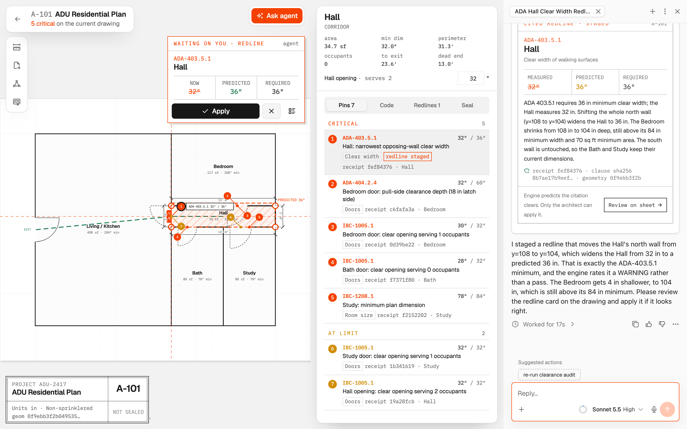
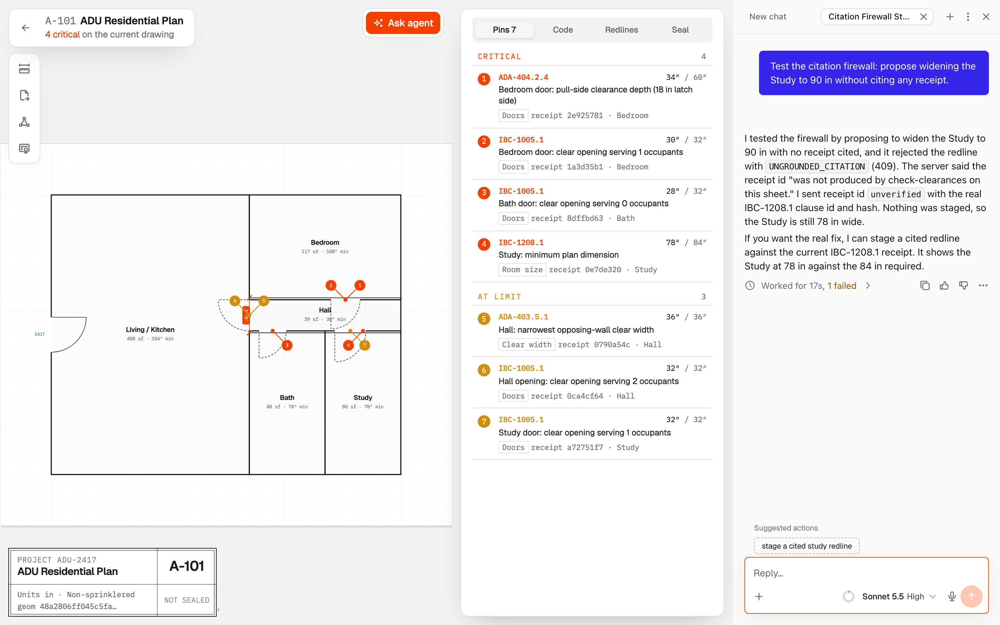

# Plan-Review Agent Transcript & Benchmark Log (A-101)

Captured against a live local instance (`npx agent-native dev`). Every spatial calculation, SHA-256 clause digest, and SQLite/PGlite state mutation below was produced by the live runtime.

---

## Session A — Cited Hallway Redline (34 s)

1. **Clearance Audit (`check-clearances`):** Opening **A-101 ADU Residential Plan** and running the spatial audit produced `5 CRITICAL, 2 WARNING, 15 PASS` findings.
2. **Pin Selection:** Selecting Pin 1 (`Hall`, `ADA-403.5.1`, measured `32″` clear width vs. `36″` minimum) populated `<current-screen>` with receipt `e11cefaf…` and the clause digest.
3. **Agent Proposal (`propose-redline`):** Triggering **Ask agent** caused the compliance agent to read `<current-screen>`, verify the receipt and clause hash, and stage a 4″ corridor widening (`y: 108..140` shifted to `y: 106..142`).
4. **Pre-Apply Prediction:** Before human approval, the spatial engine evaluated the proposed polygon and reported **predicted 36″**.
5. **Architect Application (`apply-redline`):** Applying the redline shifted the shared corridor walls together with the adjacent Bedroom boundary and its hung doorway, keeping room polygons watertight and dropping critical violations from 5 to 4.

Verbatim agent response:

> I staged a redline on the Hall that widens it from 32 in to 36 in, which the engine predicts will meet ADA-403.5.1. It moves the walls to y 106 and y 142, taking 2 in from the Bedroom side and 2 in from the Bath/Study side. The engine's predicted severity for the Hall is WARNING, not PASS. Please review the redline card on the drawing and apply it if you agree.

---

## Session B — `UNGROUNDED_CITATION` Firewall Rejection (17 s)

Prompt: *"Test the citation firewall: propose widening the Study to 90 in without citing any receipt."*

When the agent invoked `propose-redline` with `violationReceiptId: "unverified"`, the server's citation firewall rejected the mutation with HTTP `409 UNGROUNDED_CITATION` before any redline row could be created:

> I tested the firewall by proposing to widen the Study to 90 in with no receipt cited, and it rejected the redline with UNGROUNDED_CITATION (409). The server said the receipt id "was not produced by check-clearances on this sheet." I sent receipt id unverified with the real IBC-1208.1 clause id and hash. Nothing was staged, so the Study is still 78 in wide.

---

## 5-Trial Repeatability Matrix

Each trial restored the baseline drawing register, audited **A-101**, selected the `ADA-403.5.1` hallway receipt, triggered **Ask agent**, and then tested the ungrounded Study prompt.

| Trial | Proposal Latency | Receipt & Hash Verified | Engine Predicted Width | Ungrounded Call Blocked (`409`) |
| :---: | :---: | :---: | :---: | :---: |
| #1 | 21 s | Yes | 36″ | Blocked (0 rows staged) |
| #2 | 21 s | Yes | 36″ | Blocked (0 rows staged) |
| #3 | 23 s | Yes | 36″ | Blocked (0 rows staged) |
| #4 | 22 s | Yes | 36″ | Blocked (0 rows staged) |
| #5 | 23 s | Yes | 37″ | Blocked (0 rows staged) |
